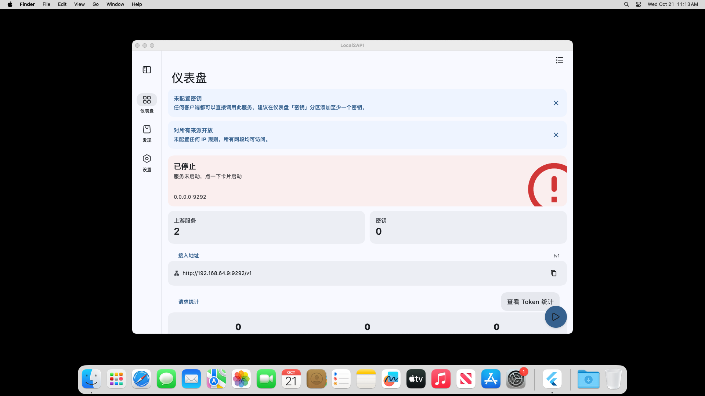
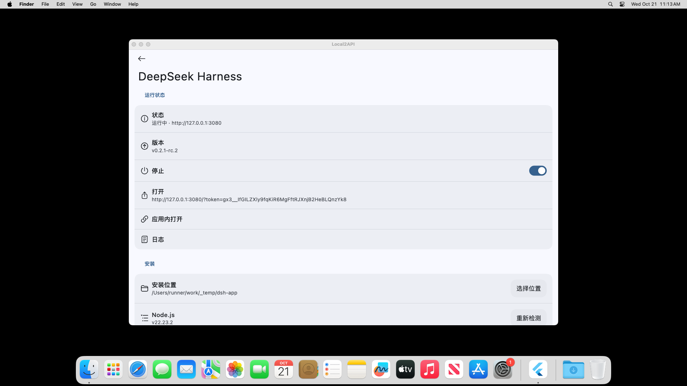
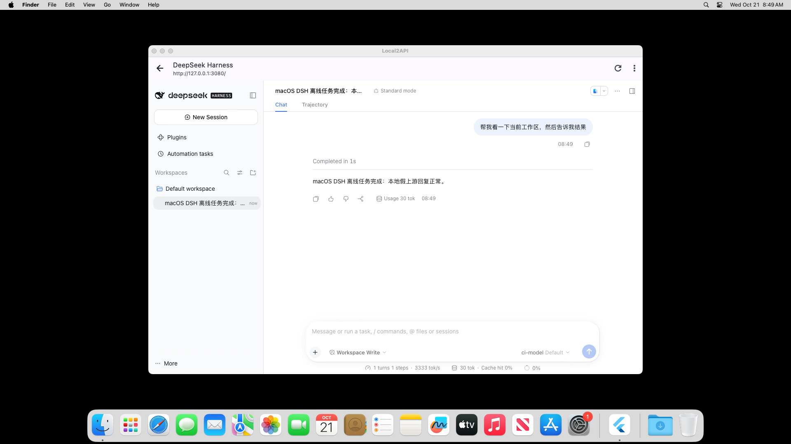
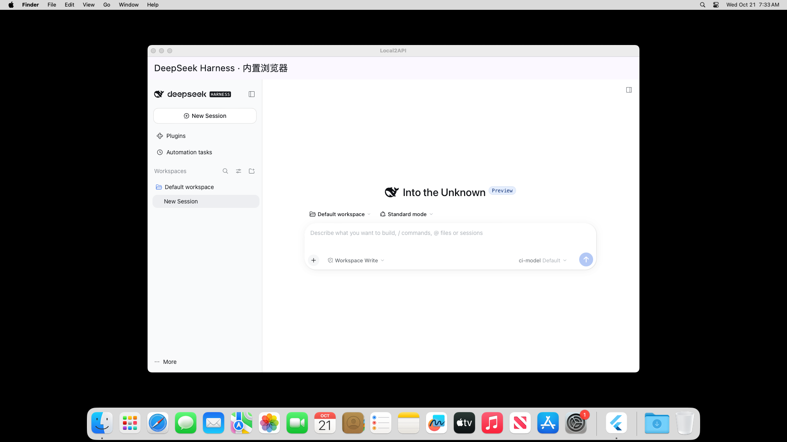

<div align=center>

<h1>Local2API</h1>

</img>
</img>
</img>
</img>
</img>

<p>把局域网 / VPN 里的 <b>llama.cpp</b>、<b>Ollama</b> 或任意 <b>OpenAI 兼容接口</b>，
转发成带鉴权与模型白名单的一层新 API，方便本地部署或云端分享。
界面有 Material 与 miuix（HyperOS 风格）两套，随时可切。</p>

</div>

```
客户端(任意 OpenAI SDK) ──Bearer Key──▶ Local2API(手机/设备) ──按模型路由──▶ llama.cpp / Ollama / OpenAI 兼容端点
```

## 支持平台

- Android 8.0 及以上（arm64 / x86_64）
- Windows 10 及以上
- macOS 14 及以上（Apple Silicon / Intel）
- Linux（实验性）

## 屏幕截图

<table>
  <tr>
    <td></td>
    <td></td>
  </tr>
  <tr>
    <td></td>
    <td></td>
  </tr>
</table>

## 功能

- **上游管理**：添加多个上游（llama.cpp / Ollama / OpenAI 兼容），一键拉取模型列表、测试连通性
- **模型白名单 + 别名**：只对外暴露勾选的模型，可重命名（`gpt-4o` → 内网的 `qwen2.5-14b` 之类都行）
- **广场（预设规则库）**：第五个导航位，把「一套上游 + 一批模型」做成可按需启用的预设规则
  （目录在 `lib/models/plaza_rules.dart`），两种粒度：
  - **上游预设**：一条规则 = 一个上游（地址 / 是否要 Key / 一批模型车道），启用即写进现有
    上游体系；停用只翻 `enabled`，不删用户手工加过的东西
  - **路由策略**：一条规则 = 一个对外模型名 → 按顺序回退的候选车道（`ModelEntry.fallbacks`）。
    代理转发时首条被拒就自动换下一条：中间失败只读响应头、不写客户端，
    最后一条无论什么状态都照实回传，SSE 流式透传不受影响
  - **卡片点进去是车道列表页**（`plaza_lanes_page.dart`，照 ClashMetaForAndroid
    的代理页 `design_proxy.xml` + `ProxyView.kt` 搬）：一行一条车道，左侧「节点名 +
    服务器」两行文字，右侧居中一个**延迟数字**（探测时的请求往返耗时，就是代理测延迟
    那一套），当前车道整行换 `secondaryContainer` 底色并带勾；闪电图标同时放在工具栏
    （测试期间换成进度圈，对应 CMFA 的 `url_test_view` / `url_test_progress_view` 互换）
    和右下角 FAB，两处都触发「测全部」。点一行 = 选它：路由策略把它提到回退链链首，
    上游预设则单独暴露 / 收起这条车道
  - 探测结果与「正在测试」状态放在 `plazaLaneResults`（ChangeNotifier）里按车道名共享，
    所以广场卡片和车道列表页看到的是同一份数据，来回导航不丢结果
  - **`*-free` 车道要带桌面客户端指纹**（根因与修复，见 `lib/services/zen/`）：早先设备实测
    「14 条里只有 `space-bunny-free` 返回 200，其余 403 FreeTierError」，那条结论是错的 ——
    不是上游只放行一条，而是我们发的裸 OpenAI 请求没声明客户端身份。对照
    [dsh-our-free-model](https://github.com/Ebony-Vinyl/dsh-our-free-model)（MIT 协议层参考）
    与它的 Go 移植 [zen-gate](https://github.com/LAGcomcom/zen-gate) 补齐了四件事：
    - 每个请求（含 `GET /v1/models`）带 `Authorization: Bearer public`（这条车道本身的公开免密
      额度，不是谁的私人 Key）、`User-Agent: opencode/1.18.31`（网关下限 1.17）、
      `x-opencode-client/session/request/project`；**同一会话必须稳定** —— 免费额度按
      session 计，每请求新铸一个 id 会撞 429
    - `ses_` 的 12 位 hex 前缀不是哈希，是**现铸的取反时间戳**：`~(ms<<12 | seq&0xFFF)` 的
      6 字节大端（`seq` 是每毫秒归零的进程内单调计数器，固定 `+1` 会让同一毫秒内的两个会话
      撞出同一个前缀）。前缀不合公式一律 403 FreeTierError；`msg_` 的前缀上游不校验，仍走
      sha256 派生。会话 id 的**重铸周期是 6 天**（不是半小时）：上游免费档容忍约一周内的
      前缀，6 天重铸刚好留在窗口内，`zenSessionIdUsable` 的新鲜度窗口同样收到 6 天，保证
      「缓存里的 id 一定还能用」。过期判定看**铸造时刻**而非最后使用时刻 —— 否则一条天天
      在用的会话永远不重铸，第 7 天开始悄悄 403
    - 上游 body 只有 `{"model", "stream": true, …}`，**三条线一律不带 `stream_options`**
      （客户端自己带进来的也在 chat 线上摘掉）：真实 opencode 客户端从不发这个字段，只有
      zen-gate 那条带账号凭据的 WorkBuddy 渠道发。`stream:true` 本身是硬要求 —— 免费档指纹门
      只放行流式请求，客户端要整份 JSON 时由转译器攒完回灌。代价是上游可能一帧 usage 都不回，
      token 统计于是优雅降级（不带 `usage` 键、代理跳过记账，不抛异常）
    - `body.tools` 必须声明小写 `bash`/`glob`/`grep`/`read` 四件套，缺一个整条 403；
      大小写变体归一（上游把 `Bash`+`bash` 当重复拒绝），有真工具能顶替就提升（`pwsh`→`bash`）
      而不是塞诱饵，并留一张改名表在响应侧把工具名还原回调用方的拼写
    - 按模型分流线协议：多数车道走 `/zen/v1/chat/completions`，`muse-spark*` 走
      `/zen/v1/responses`，`union-alpha` 走 `/zen/v1/messages`；后两条做出站体转换 +
      入站 SSE/整份文档回译成 OpenAI chat 形状，客户端不用知道上游换了协议。
      `jev-*` 是 System One 判定模型（不产文本），目录里已剔除，手填进来会直接收到一句人话拒绝
    - 车道集合以 `GET /v1/models` 为权威（探测前先刷新），`lib/models/builtin_profiles.dart`
      的 `kZenFreeLanes` 那份常量表退化为冷启动/断网兜底 —— 内容与顺序照抄 zen-gate 的
      `FallbackCatalogIDs`（8 条，`mimo-v2.6-flash-free` 打头、`muse-spark` 系置末）；
      免密白名单 `_alwaysFree` 也只有 `union-alpha` 与 `space-bunny-free` 两条。
      上游上新一条免密车道不用改代码发版
    - 判定细分为「可用 / 仅限官方客户端 / 额度已达上限 / 出口地区受限 / 模型当前不可用 /
      请求自身被拒」—— 429 与 RegionError 都会自行恢复或换出口就好，和「这条车道坏了」
      不是一回事，UI 上不再糊成同一个红色；`muse-spark` 系走国内出口如实显示地区受限而非不可用。
      两条新分支：**前置代理的 HTML 错误页**（WAF / 请求体过大）优先于 401/403 判定归到
      「请求自身被拒」，否则会被误读成凭据失效把整条车道标红；**其余 4xx（408/425 除外）**
      同样归这一类而不是 server —— 重放同一份 body 只会得到同一句拒绝，换道重试纯属白烧。
      429 且没带 `Retry-After` 时默认只冷却 **10 秒**（不是 60 秒）：`Bearer public` 是全球
      共享凭据，429 只代表此刻拥挤，实测最短 0.6 秒就恢复，冷却一分钟等于让整条 `zen-free`
      在用户眼里「又失效了」
- **仪表盘（原服务页）**：导航只留三项（仪表盘 / 广场 / 设置），上游管理、对外模型
  白名单、API 密钥全部内联成仪表盘的分区（`dashboard_page.dart` 汇总
  `dashboard_server` / `dashboard_models` / `dashboard_keys` 三个分区文件），
  不再有独立的模型页和密钥页
- **每页一个 FAB**（`home_fab.dart`，窄屏与宽屏共用）：仪表盘 = 启动/停止服务
  （扩展 FAB，随 `ServerState` 实时换图标文案）、广场 = 刷新（重跑车道探测，
  跨规则按车道去重只打一次网络）、设置 = 外观快速面板（主题模式 / 纯黑 / 动态取色，
  与显示设置页同一份 `SettingsService` 状态）。FAB 位置抬到底栏槽之上，不压玻璃胶囊
- **API 密钥**：给客户端发一层自己的 `sk-...` 密钥，支持启用/停用；未配置密钥时不鉴权（首页有提醒）
- **IP 访问规则（CIDR）**：按顺序匹配、先命中先生效；留空 = 全部放行。可做「仅局域网/VPN 网段」或「指定公网段白名单」
- **流式转发**：SSE 逐块透传，`chat/completions`、`completions`、`embeddings` 等 `/v1/*` 全量透传
- **CORS**：可选允许网页前端直连
- **请求日志与统计**：状态码 / 模型 / 客户端 / 耗时
- **对话模拟**：每个模型组一格本地存档，三种角色（系统 / 用户 / 助手）都能手改，
  请求走自己的代理（路由 / 容灾回退 / Zen 指纹 / 日志全过一遍），加载角色卡后顶栏
  直接顶角色名。**助手消息长按**弹操作菜单：复制 / 删除 / 朗读 / 重新回答 /
  **下载音频**（`lib/services/tts/tts_message_export.dart`）
  - 下载可选 **MP3 / SILK / SLK** 三种容器（SILK 与 SLK 字节完全一致，只是扩展名
    不同），弹窗里选格式；SILK 系带 **`-tencent`（腾讯兼容）** 开关，默认开 ——
    文件头多一个 `0x02` 前缀字节、结尾不写 `0xFFFF` 哨兵包，微信 / QQ 才认
  - 编码器自 [NaviFlash](https://github.com/memz2345/naviflash) 移植：
    `android/app/src/main/cpp/`（SILK 定点 SDK + LAME 3.100 编码子集，纯 C，
    编成 `libttsexport.so`，Dart 侧 FFI 见 `lib/services/tts/tts_export_native.dart`），
    **仅 Android**；其余平台菜单里不露「下载音频」这一项
  - 合成与朗读共用同一条路线决策（`ChatTts.decideRoute`）与同一条合成路径，
    所以下下来的就是喇叭会播的那段

- **实验室（dsh / SillyTavern）**：手机或桌面直接跑 DeepSeek Harness 的 web 端。
  插件管理页照 KernelSU 模块页做：搜索框、可折叠的内置/第三方分组、一卡一插件
  （描述可展开），内置「编辑消息 / 电脑操作 / 手机操作」三条推荐，也能按 npm
  包名装第三方的；开关只改 `dsh.profile.bundles`，卸载才真删包
- **开源许可**：关于页里的完整依赖清单（NOTICES + `pubspec.lock` 版本），
  支持按包名 / 版本 / 许可标识搜索，单包内看每份许可全文并一键复制

接入地址即 `http://<本机IP>:<端口>/v1`，服务页可一键复制。

## Base URL 约定

| 上游填写 | 转发结果 |
| --- | --- |
| `http://192.168.1.10:8080/v1`（llama.cpp / Ollama / OpenAI 常规） | `base + /chat/completions` |
| `http://192.168.1.10:8080`（不带 /v1） | `base + /v1/chat/completions` |

两种写法都支持，Ollama 拉模型优先走原生 `/api/tags`。

## UI 特性（自 [NaviFlash](https://github.com/memz2345/naviflash) 移植）

- **iOS 页面推入转场**：`IosPushPageTransitionsBuilder` 全平台注册在 `pageTransitionsTheme`，
  替代 Flutter 原生动画（右滑入 + 圆角收拢 + 旧页左移压暗），所有 `MaterialPageRoute`
  自动生效；子页面统一走 `pushPage`（MaterialPageRoute，NaviFlash 设置页同款转场路径），
  转场文件与 F:
aviflashv2 带注释版逐字一致
- **两套顶部标题栏（自 NaviFlash 移植）**：
  - **悬浮毛玻璃顶栏**（`frosted_page_bar.dart`，分区 / 消息同款）——`FrostedPanel`
    0.75 + blur 12 + 56px 单行，顶栏是**悬浮层**而不是 `Scaffold.appBar`，内容铺满整页、
    滚动时从毛玻璃下面穿过才有东西可糊，首屏由内容自己垫 `frostedPageBarInset()`；
    往下滚过 120px 标题行整行收掉（`Align.heightFactor` 220ms，不改布局高度）、
    往上滚或回到顶部立刻放回。已用于请求日志、新建/编辑上游
  - **扩展标题栏**（`ExpressiveSliverAppBar`，设置页同款）——28sp 大标题随滚动折叠成
    16/w600 毛玻璃标题行（260ms 交叉淡入淡出），已用于三个导航主页面
    （仪表盘 / 广场 / 设置），取代原来的 `PageHeader`（已删除）
  - 顶栏里的按钮统一用 `MorphIconButton`：按下时圆形变方（radius 14，70ms
    fastOutSlowIn），返回键 `transparent` 无底、操作键同款式
  - 折叠行为由 `test/frosted_page_bar_test.dart` 三个用例钉住（悬浮层判定 /
    滚过阈值收起再滚回放回 / 关掉折叠开关）
- **渐变模糊顶栏（AppMarket 同款，两套风格都有）**：设置「外观 → 渐变模糊顶栏」
  （`SettingsService.progressiveTopBar`，出厂关，只在渲染路径跑得动 fragment
  shader 时才露这一行）
  - 顶栏本体全透明，上面叠一条**渐进模糊带**：从顶边满强度沿渐变溶解到底边的
    完全清晰，内容滚到栏下是渐渐糊掉，而不是撞上一条硬边
  - 实现是 vendored `liquid_glass_widgets` 的 `ProgressiveBlur`（一次 backdrop
    采样 + 两趟可分离高斯着色器，`shaders/progressive_blur.frag`），对应 Compose
    侧的 `Modifier.progressiveTextureBlur`。Material 侧包成 `GradientBlurPanel`
    （`expressive_app_bar.dart`，接 `FrostedPageBar` 与 `ExpressiveSliverAppBar`），
    miuix 侧是 `MiuixGradientBlurTopBar`（`widgets/miuix/`）
  - **淡入只能靠改 `maxSigma`，不能在外层套 `Opacity`**：祖先 `Opacity` 会
    `saveLayer` 另起一个 backdrop root，里面的 `BackdropFilter` 就糊不到组外
    滚上来的页面内容，画面上只剩一层半透明色 —— 看上去就是「透明、没模糊」。
    早先的多切片实现（14 片 `BackdropFilter` 逼近变半径）正是栽在这上面，已删。
    两侧各有一条回归用例守住这个不变量
    （`test/gradient_blur_panel_test.dart`、`test/miuix_gradient_blur_top_bar_test.dart`）
  - 参数照 AppMarket `BlurExt.kt`：`blurRadius 10`（× 0.45 → sigma 4.5）、
    `surface @ 30%` 压字、带高 `max(状态栏 × 2, 56dp)`。miuix 侧模糊带刻意画在
    顶栏**之下**（AppMarket 画在之上，但它那条栏折叠后没有小标题，盖住无妨；
    我们有标题和动作图标，盖上去会被洗淡一层）
- **液态玻璃底栏（双模式）**：
  - **Android 默认：平台通道原生底栏**（NaviFlash 同款）——ComposeView 悬浮在 FlutterView 上，
    PixelCopy 抓 Flutter 画面做折射背景，Kyant0 `backdrop`/`shapes` 渲染真液态玻璃胶囊
    （`LiquidGlassBarHost.kt` + `LiquidGlassBarMotion.kt` + `LiquidGlassShaders.kt`），
    点击经 MethodChannel 回传 Flutter，压入新页面时 RouteAware 自动隐藏、返回自动恢复，
    `show()` 失败自动永久回退 Flutter 模式
  - **玻璃背景同步**：抓回来的是一帧旧画面（天生滞后 1~2 帧），所以底栏可见期间
    用 post-frame 回调链**逐帧**告诉原生「这一帧有新内容」（不额外排帧，静止时链条自己停），
    原生一律在 Choreographer 帧头发起 PixelCopy；同时把可见页的**绝对滚动位置**交给原生，
    绘制时按「当前位置 − 该帧位置」平移旧图做补偿（上限 = 抓取边距 40dp），
    切页 / 尺寸变化走 epoch 让旧图作废。静止时退回 500ms 心跳，兜住非滚动引起的画面变化。
    `adb logcat -s LiquidGlassBarHost` 每 2s 打一行 `sync:` 汇总（抓取速率 / 单次耗时 / 补偿量）
  - **Flutter 模式**：vendored `liquid_glass_widgets`（0.30.2 含底栏拖拽崩溃补丁）的 `GlassTabBar.bottom`
- **原生 tooltip**（NaviFlash 同款）：`AppTooltip` 组件替换 Material Tooltip——Android 上经
  `NativeTooltipHost.kt` 用 PopupWindow + Compose 在 anchor 上方渲染原生气泡（长按 1.5s 触发），
  非 Android 或关闭时回退 Flutter `Tooltip`；已应用于复制/删除/添加等按钮
- **原装 toast**（NaviFlash 同款）：`showAppToast` 双模式——默认走 **Android 原生 Toast**
  （`fluttertoast`），开启设置后走 SmartDialog + `CustomToast` 玻璃毛玻璃气泡
  （径向渐变高光 + ImageFiltered 模糊）
- **显示设置**（NaviFlash `DisplaySettingsScreen` 原样 UI，Morph 卡片体系）：
  - 主题模式（系统/浅色/深色）+ 纯黑模式（OLED）
  - **主题颜色**：Material You 动态取色开关（Android 12+，`AppDynamicColorBuilder` +
    壁纸/深色变化原生监听）、Flex 种子方案变体（`flex_seed_scheme`）、预设色板 +
    自定义颜色（flutter_colorpicker）
  - **从图片取色**：`ImagePicker` 选图 → isolate 内 `image` 库解码 → 过滤近黑/近白像素
    加权平均 + 饱和度提升 → 存为自定义主题
  - **字体粗细**（字重 300-800，九档 TextTheme 全局应用）、**显示大小**
    （0.7x-1.4x，MediaQuery 度量除法 + Transform.scale，NaviFlash 同款实现）
- **遇见式返回（Predictive Back）**：
  - Android 14+ 系统级：`android:enableOnBackInvokedCallback="true"`
  - 应用内：`PredictiveBackGestureDetector` 挂在转场层，手指拖动时线性跟手，松手提交/回弹；
    底部弹窗走 `showAppBottomSheet` 同样跟手
- **M3E 加载动画**：`LoadingIndicatorM3E`（Material 3 Expressive 形变形状动画）
- **常驻侧边栏（rail）**：宽屏/横屏（≥768）自动切换 `SideBarShell`——左侧
  `CollapsibleSideBar`（收起 = M3 竖向导航栏 80px，menu 展开 = Gmail 胶囊列表 224px，
  NavigationIndicator 同款选中动画，展开状态全局持久化），右侧圆角内容卡片；
  窄屏仍走液态玻璃底栏
- **页面背景**：全部页面统一 NaviFlash 画布模式——`scaffold` 底色
  `surfaceContainer` + `PageBackground` 微渐变，纯黑模式自动同治
- **返回 tooltip**：所有推入页返回键统一「转到上一层级」（`startScreenGoBack`）
- **Android 12+ 开屏动画**：`values-v31` SplashScreen API（`windowSplashScreenAnimatedIcon`）
- **Android 13+ 多语言**：`localeConfig` + `LocaleManager` 通道，系统「应用语言」与 App 内设置双向同步
  （简体中文 / 繁體中文 / English）

## 构建

```bash
flutter pub get
flutter run                    # 直接跑
flutter build apk --release    # 出包
```

- 包名：`com.memz2345.local2api`
- **Android 需要 NDK + CMake**：`android/app/build.gradle.kts` 挂了
  `externalNativeBuild.cmake`（`src/main/cpp/CMakeLists.txt`，3.22.1，
  `-DANDROID_STL=none`），编 `libttsexport.so`（对话模拟的音频下载用）。
  纯 C、无 STL 依赖，首次构建会多花约一分钟编 SILK + LAME 的 187 个源文件
- 测试：`flutter test`（847 个用例，全部离线：代理核心的 CIDR、鉴权、模型路由/别名改写、
  SSE 流式、URL 归一化、序列化、有序回退；Zen 适配层的 id 形状与稳定性、免费车道判定、
  三种线协议分流、四件套指纹（归一 / 提升 / 诱饵）、出站转换、入站 SSE 与整份文档回译、
  探测分档，以及「不是 Zen 上游时字节不变」这条回归线；顶栏渐变模糊的 backdrop root
  不变量；对话模拟的长按菜单与「重新回答」截断语义）
- 原生编码器只能在 Android 上实测，走
  `flutter test integration_test/tts_export_probe_test.dart -d <设备>`：
  自己在 Dart 里合成 24kHz 正弦喂进去，验 `libttsexport.so` 打得开、
  SILK 的 tencent / 非 tencent 两种容器头与包边界、SLK 与 SILK 字节一致、
  MP3 帧同步头。**注意这条命令跑完会把 App 卸载、连带清掉设备上的存档数据。**

### macOS 桌面端

```bash
flutter pub get
flutter build macos --release
# 产物：build/macos/Build/Products/Release/Local2API.app
```

- **需要 macOS 14+**：`llamadart_llama_cpp_flutter` 的 SwiftPM companion 最低要求
  macOS 14.0（Xcode 的 `MACOSX_DEPLOYMENT_TARGET` 钉在 14.0）。macOS 端插件全部
  走 Swift Package Manager，不需要 CocoaPods / Podfile。
- App Sandbox 关闭：要执行系统 `node` / `npm`、读写 `~/.dsh`、拉起实验室里的
  DSH / SillyTavern；Info.plist 同时放开 ATS 明文 HTTP（上游和本地服务基本都是
  `http://127.0.0.1`）。
- 内置浏览器在 macOS 走 `webview_flutter` 的 WKWebView；实验室 DSH 用系统 Node，
  与 Windows 共用同一条 `DshService` 路径。
- CI：`.github/workflows/macos.yml` 在 `macos-14` 上构建 release、预装
  `@deepseek-ai/dsh`、跑 `integration_test/macos_dsh_smoke_test.dart`；
  DSH 设置页与 DSH Web UI 的截图、未签名 `.app` 都在 run artifacts 里。
- CI 产物只做 ad-hoc 签名；下载后首次打开请右键「打开」，或执行
  `xattr -cr Local2API.app` 去掉 quarantine。

## 注意

- 上游多为 `http://` 明文，Manifest 已开 `usesCleartextTraffic`
- 广场只收录 Zen 免密车道。`dsh-our-free-model` 里还有第二条渠道（EAC 协付：DeepSeek V4.1
  Flash / Kimi K3 / GLM 5.3 等），**不搬**：它的端点与凭据在对方仓库里只以 AES-256-GCM 密文
  存在，密钥要由分散的分片在授权桌面宿主的指纹闸门下即时派生，而且它不是免费额度（凭据由
  插件方承担、可在签名网关侧吊销）。既没有可填进广场的地址，破那个密封也不是该做的事
- 服务运行依赖 App 进程存活；息屏/后台被杀即停止（前台服务保活属后续计划）
- **MP3 编码必须用 `lame_encode_buffer`，不能用 `lame_encode_buffer_interleaved`**：
  后者内部按 stride 2 从 `pcm` 与 `pcm+1` 各取 n 个 short，等于要读到
  `pcm[2n-1]`；我们喂的是单声道（只有 n 个 short），于是越界读 n 个，
  撞在页边界就是 SIGSEGV（x86_64 模拟器实测复现，`tts_mp3_encode+516`）。
  单声道的正确写法是 L/R 传同一个缓冲、stride 1 —— NaviFlash 那边同一份代码
  有这个隐患（原生编码从来没被自动化验过），值得同步修
- 配置存储于 shared_preferences（单键 JSON），随 App 卸载清除

## 开源许可

「关于 → 开源许可」里是完整的依赖清单（来自 Flutter 的 NOTICES），
支持按包名 / 版本 / 许可标识搜索，点进包内可看每一份许可全文，
顶栏一键复制全文。Material 与 miuix 两套各有一份。

## 致谢

特别感谢 [Miuix](https://github.com/compose-miuix-ui/miuix) —— 本项目 miuix 风格界面的
设计语言、组件规范与动效全部来自这套 Compose 组件库；也感谢
[flutter_miuix](https://github.com/ChuxinNeko/flutter_miuix) 把它移植到 Flutter，
以及所有 Miuix 用户：是你们把「HyperOS 观感」一点点打磨成第三方 Flutter 应用也能直接用的东西。

感谢 [KernelSU](https://github.com/tiann/KernelSU) 的模块页（`ModuleMiuix.kt`）——
dsh 插件管理页的分组折叠、搜索与卡片层次照着它做的。

感谢 [InstallerX-Revived](https://github.com/wxxsfxyzm/InstallerX-Revived) —— 关于页、
纹理集调试面板与 miuix 卡片的按压手感参考了它。

感谢 [NaviFlash](https://github.com/memz2345/naviflash) —— 大量 UI（毛玻璃顶栏、
液态玻璃底栏、显示设置）与 TTS 编码器是从它移植过来的。

感谢 [Kazumi](https://github.com/Predidit/Kazumi) —— README 的排版、徽章与致谢写法照它抄的。

感谢 [DeepSeek Harness](https://github.com/deepseek-ai/dsh) —— 实验室里的 dsh 集成与插件生态都跑在它上面。

感谢 [所有贡献者](https://github.com/memz2345/local2api/graphs/contributors)，本项目因为你们变得更好。
